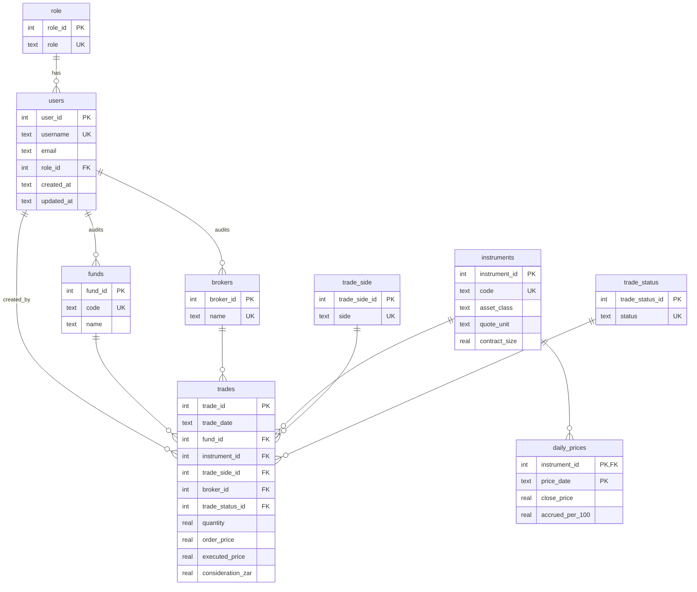

# Database (SQLite)

Schema follows the same conventions as the NMA reference ERD:

- **snake_case** table and column names  
- **`{entity}_id`** primary keys  
- **Lookup tables** for enums (`role`, `trade_status`, `trade_side`) instead of hard-coded CHECK lists on facts  
- **Audit columns** on domain tables: `created_at`, `updated_at`, `created_by`, `updated_by`  
- **Central fact table** `trades` with FKs to reference entities  

## Load

Preferred (tracks applied files for future `003_*.sql`, …):

```bash
python backend/seed.py
```

Manual:

```bash
sqlite3 trade_ledger.db < database/001_schema.sql
sqlite3 trade_ledger.db < database/002_data.sql
```

## ERD (HTML)

Open in a browser: [`database/erd.html`](erd.html) — SVG diagram plus column cheat sheets.

## Entity map (Mermaid)



`002_data.sql` order: **role → users → lookups → instruments → daily_prices → funds → brokers**